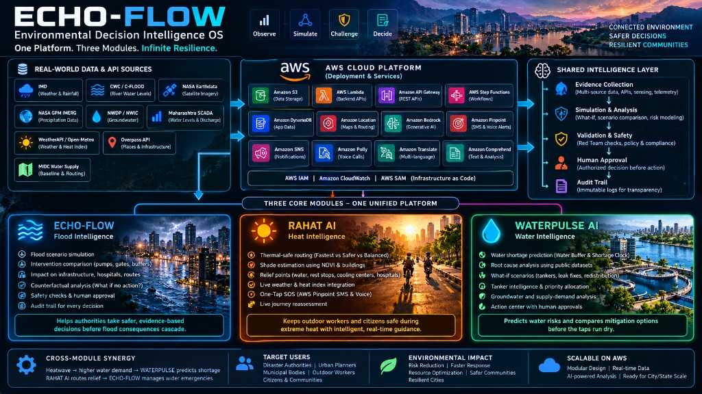

# 🌍 ECHO-FLOW — Environmental Decision Intelligence OS

**One Platform. Three Modules. Infinite Resilience.**

<p align="center">
  
</p>

Welcome to **ECHO-FLOW**, an advanced Environmental Decision Intelligence Operating System. More than just a dashboard that plots data on a map, ECHO-FLOW is designed to **understand scenarios, simulate interventions, compare consequences, and enforce human approval** before taking action. 

It is built as a unified product divided into three independent but deeply interconnected modules, powered by an underlying AWS Cloud Architecture and Generative AI.

---

## 🧠 The True Power: Shared Intelligence Layer
A standard dashboard simply shows data. ECHO-FLOW's primary objective is to use data to understand potential crisis scenarios, simulate multiple solutions, compare their outcomes, and record actions only after strict human approval. 

This is achieved through a **Shared Intelligence Layer** across all three modules:
`Evidence ➔ Simulation ➔ Validation ➔ Human Approval ➔ Audit Trail`

**Cross-Module Synergy (Example):**
If an extreme heatwave triggers a sudden spike in municipal water demand, **WATERPULSE** predicts the shortage risk. Simultaneously, **RAHAT AI** calculates thermal-safe routes for outdoor workers delivering emergency supplies, while the **ECHO-FLOW Command Center** manages broader infrastructure emergencies. *(Note: The platform is built to handle this cross-module data exchange when deployed fully on AWS).*

---

## 🏗️ The Three Core Modules

### 1. 🌊 ECHO-FLOW — Flood Intelligence
**A decision-support system to understand and manage floods and environmental emergencies.**
*   **What it is:** The strategic command center for disaster management authorities.
*   **Key Capabilities:**
    *   **Scenario & Impact:** Simulates flood scenarios and analyzes the direct impact on infrastructure, hospitals, and emergency routes.
    *   **Intervention Comparison:** Compares the effectiveness of deploying pumps, creating water buffers, or opening diversion gates.
    *   **Counterfactual Analysis:** Asks the critical question—*"What will happen if we take no action?"*
    *   **Safety & Compliance:** Features a Red Team evaluation, safety checks, and strict human approval workflows, backed by an immutable Audit Trail.
*   **Problem Solved:** Helps authorities understand which intervention options are safe, what the cascaded consequences might be, and what risks must be evaluated *before* making a final decision.

### 2. ☀️ RAHAT AI — Heat Intelligence
**A thermal-aware routing system designed for delivery riders, couriers, cyclists, and outdoor workers.**
*   **What it is:** An on-the-ground, mobile-first survival application for citizens navigating extreme heat and crisis zones.
*   **Key Capabilities:**
    *   **Thermal Routing:** Compares routes not just by distance, but by exposure: **"FASTEST" vs. "THERMAL-SAFE" vs. "BALANCED"**.
    *   **Shade & Weather:** Calculates estimated shade based on buildings and greenery (NDVI), integrating real-time weather and solar exposure estimates.
    *   **Relief Intelligence:** Automatically maps crucial relief points like drinking water, rest stops, cooling centers, and hospitals.
    *   **Instant Help:** Features live journey reassessment and a critical **"I NEED RAHAT" / One-Tap SOS** button that instantly dispatches AWS Pinpoint SMS and Voice calls with live GPS coordinates.
*   **Problem Solved:** Moves beyond traditional "shortest-path" navigation by prioritizing human safety, minimizing thermal exposure, and dynamically routing citizens to active relief points.

### 3. 💧 WATERPULSE AI — Water Intelligence
**A proactive system to predict water shortages and compare mitigation strategies.**
*   **What it is:** The environmental telemetry, supply-demand, and forecasting module.
*   **Key Capabilities:**
    *   **Shortage Prediction:** Features a live "Water Buffer" and "Shortage Clock" based on the supply-demand balance.
    *   **Root Cause Analysis:** Analyzes *"Why is this happening?"* using public datasets and evidence views.
    *   **What-If Scenarios:** Simulates the outcomes of various interventions: deploying a tanker fleet, fixing leakages, redistributing supply, or taking no action at all.
    *   **Action Center:** Manages Tanker Intelligence, human approvals, and verification of actions.
*   **Problem Solved:** Instead of reacting only *after* the water runs out, Waterpulse uses telemetry data and assumptions to understand shortage risks in advance and compare viable mitigation strategies.

---

## 📡 Real-World Data & API Integrations

To make the platform highly accurate and applicable to real-world scenarios, we integrate several live data sources and APIs:

1.  **Amazon Location Service API:** Used for rendering live geographic maps (Base maps) and calculating real-time routes.
2.  **WeatherAPI & Open-Meteo:** Fetches live weather data, temperature, and heat-index to calculate "Heat Exposure" in RAHAT AI.
3.  **Overpass API (OpenStreetMap):** Dynamically queries local infrastructure (hospitals, schools) to automatically generate "Relief Points".
4.  **NASA Earthdata & Planetary Computer STAC:** Fetches live satellite imagery context (*Sentinel-2* for Vegetation/NDVI, *Landsat-8* for surface temperature).

### 🏛️ Indian Government Datasets Used (WATERPULSE)
The Waterpulse module heavily relies on authentic telemetry data from the Government of India, primarily sourced from the **National Water Data Portal (NWDP)** and **Open Government Data (OGD) Platform India**:

*   **Ground Water Level (Telemetry – Hourly), Delhi** (Source: NWIC, Ministry of Jal Shakti).
*   **Water Level and Discharge, SCADA (Hourly), Maharashtra SW** (Source: Maharashtra Surface Water Department).
*   **Reservoir Discharge — Bhima–Sina Link Canal, Maharashtra** (Source: Maharashtra Surface Water Department).
*   **MIDC Water Supply Schemes (Baseline Data: 2025-2026)** (Source: MIDC via OGD Platform India).

### 📊 Data & Simulation Status (ECHO-FLOW Command Center)
**Important Note for Demonstration:** The Echo-Flow Command Center currently runs in a **Synthetic Demonstration Mode** (`FLOOD · SYNTHETIC · REV 0`). Data shown on the screen (affected population, water depth, demo entities) are *simulated inputs* for testing the AI decision-making engine, NOT live flood measurements.
*   **LIVE Integrations:** Amazon Location Service (Maps/Routes), OpenStreetMap (Basemaps).
*   **Planned/Identified Data Sources:** IMD (Rainfall/Forecasts), CWC / C-FLOOD (River levels), NDMA SACHET (CAP Alerts), NASA GPM IMERG (Rainfall estimates), Copernicus Sentinel-1 SAR (Flood extent).

---

## 🏆 AWS Hackathon Eligibility & Alignment

To satisfy the hackathon criteria (**"Use at least one AWS open source tool OR be deployed on AWS"**), the ECHO-FLOW platform fulfills both tracks:

### 1. 🛠️ BUILD IT: AWS Open Source Tools (On Machine)
*   **AWS SAM CLI (Serverless Application Model):** Used as our open-source Infrastructure-as-Code (IaC) tool across all three modules (`echo-flow/infra/template.yaml`, `rahat-ai/infrastructure/aws/template.yaml`, and `waterpulse/infra/template.yaml`). The repository contains full `.aws-sam` build templates for serverless microservices.

### 2. 🚀 SHIP IT: AWS Cloud Services Deployed
*   **Production Hosting & Storage:** Deployed on **Amazon S3** static website hosting with S3 cloud storage for public asset distribution.
*   **Event-Driven Messaging & Plumbing:** **Amazon SNS** (`ECHO-FLOW-DISASTER-ALERTS`) and **Amazon Pinpoint (SMS/Voice)** for emergency dispatch.
*   **GenAI & Intelligent Services:** **Amazon Bedrock (Claude 3.5)**, **Amazon Polly (Text-to-Speech)**, **Amazon Translate**, **Amazon Comprehend (Severity Analysis)**, and **Amazon Location Service (GIS & Routes)**.

---

## ☁️ AWS Cloud Architecture (12+ Services)

To demonstrate enterprise-grade scalability, resilience, and security, the ECHO-FLOW platform incorporates a deep AWS Cloud Architecture. For transparency, we have divided this into services that are **currently live in the prototype** versus those **architected for production scaling**.

### 🟢 Currently Implemented & Live in Local Prototype
1.  🧠 **Amazon Bedrock (Claude 3.5):** Integrated for complex adversarial reasoning and Generative AI multi-agent orchestration (Counterfactual, Relief, Coordinator).
2.  🗺️ **Amazon Location Service:** Core GIS engine used extensively across `echo-flow` and `rahat-ai`. Provides live map vector tiles, reverse geocoding (Places API), and exact route calculations.
3.  📲 **Amazon Pinpoint (SMS & Voice v2):** The backbone of the **RAHAT AI One-Tap SOS**. Programmatically triggers transactional SMS and Automated Voice Calls to verified emergency contacts within seconds of the SOS trigger.
4.  🌐 **Amazon SNS (Simple Notification Service):** Connected to the SOS workflow. Automatically creates a `ECHO-FLOW-DISASTER-ALERTS` topic and broadcasts urgent incident reports to emergency control rooms globally.
5.  🗣️ **Amazon Translate:** Integrated directly into the RAHAT AI API layer (`/api/emergency/translate`) to dynamically translate crucial survival instructions and warnings into regional languages (e.g., Hindi) during extreme heatwaves.
6.  🎙️ **Amazon Polly:** Powers accessibility in RAHAT AI (`/api/emergency/speak`). When a rider clicks "I NEED RAHAT", Polly dynamically synthesizes voice guidance (e.g., *"A nearby relief option has been found"*), allowing riders to keep their eyes on the road.
7.  🔍 **Amazon Comprehend:** Analyzes the sentiment and severity of incoming SOS distress messages in real-time. Automatically tags incidents as 'HIGH SEVERITY' if negative sentiment or panic keywords are detected.
8.  🔐 **AWS IAM (Identity and Access Management):** Enforces strict least-privilege security. Utilizes granular, scoped policies for securely invoking Bedrock models, fetching Location maps, and triggering Pinpoint messages.

### 🏗️ Architected for Production Scaling (Cloud Blueprint)
*The following services are part of our designed production deployment blueprint to handle millions of requests during an actual disaster. They are not active in the local prototype to maintain a fast, offline-capable development environment.*

5.  🔄 **AWS Step Functions:** Orchestrates the multi-agent AI pipeline in the cloud to manage the sequence of AI agents.
6.  ⚡ **AWS Lambda:** Serverless compute for lightweight, event-driven background tasks (e.g., parsing incoming NDMA CAP feeds).
7.  🌐 **Amazon API Gateway:** Secures backend REST APIs and implements rate limiting / throttling.
8.  🚀 **Amazon CloudFront:** A global CDN to cache and deliver the React/Vite frontends (PWA) and map tiles with ultra-low latency.
9.  🗄️ **Amazon DynamoDB:** A highly scalable NoSQL database for logging high-speed, unstructured disaster data. *(Currently using local SQLite)*.
10. 🪣 **Amazon S3:** Object storage for hosting static website assets and archiving historical disaster evidence and satellite data. *(Currently using local file storage)*.
11. 📡 **AWS IoT Core:** The designated ingestion layer for WATERPULSE telemetry. Securely handles high-frequency MQTT streams from SCADA systems.
12. 📈 **Amazon CloudWatch:** Centralized telemetry and monitoring for logging API requests and setting up critical alarms.

---

## 🚀 How to Run the Project (Locally)

The platform consists of **three independent backends (FastAPI/Uvicorn)** and **three frontends (React/Vite)**, all served securely behind a single Node.js local proxy.

### Prerequisites
*   **Node.js** (v18+)
*   **Python** (v3.10+)
*   **AWS CLI** (Configured with an IAM user that has access to Bedrock, Location, and Pinpoint)

### Step 1: Environment Configuration
Each module requires its own `.env` file to hold API keys securely.
1.  **Echo-Flow Backend** (`echo-flow/.env`): Configure `AMAZON_LOCATION_API_KEY`, `VITE_AMAZON_LOCATION_API_KEY`, and `AWS_REGION`.
2.  **RAHAT AI Backend** (`rahat-ai/.env`): Configure `AWS_LOCATION_API_KEY`, `WEATHERAPI_KEY`, `PROVIDER_MODE=real`, and `RAHAT_SOS_CONTACT_NUMBER`.
3.  **WaterPulse Backend** (`waterpulse/backend/.env`): Configure necessary telemetry APIs.

### Step 2: Install Dependencies
Run `npm install` and `pip install -r requirements.txt` (or via `.venv`) in the respective directories for all three modules.

### Step 3: Start the Servers
You can use the provided batch scripts (if on Windows) to launch the entire stack simultaneously:
```bash
./start-all.bat
# OR use the PowerShell equivalent
./start-silent.ps1
```
*(This automatically starts the Node Proxy on `8080`, and the respective Vite & Uvicorn servers on their assigned ports).*

### Step 4: Access the Platform
Once all servers report "Online", open your browser and navigate to the Unified Proxy:

👉 **http://localhost:8080/**

From the central hub, you can navigate seamlessly to:
*   `/echo-flow/` - Command Center
*   `/rahat/` - Citizen Emergency App
*   `/waterpulse/` - Telemetry Dashboard

---
*Built with ❤️ for rapid disaster response and public safety.*
