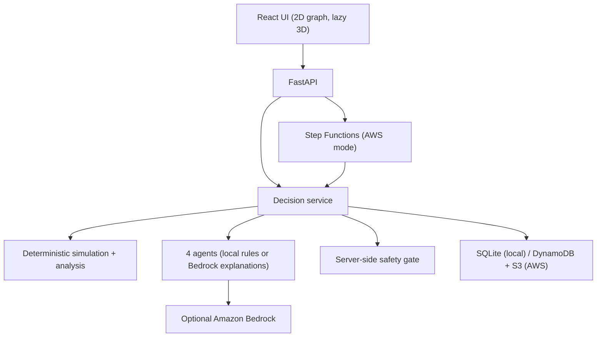
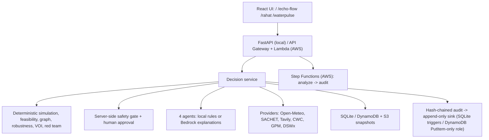

# ECHO-FLOW

**Flood & Emergency Decision Intelligence** — environmental signals become simulated, challenged, verified and
human-authorized decisions.

> ONE ENVIRONMENT. SEVEN CHALLENGES.  Test the response before the response becomes the next emergency.

Hackathon: Bharat Builds Tour 2026 — Environmental Hacks (WeMakeDevs + AWS) · Track: Heat and Water.

**AI explains. Deterministic models calculate. Humans authorize.**

The app opens directly into the **Command Center** (`/` → `/echo-flow/command`): a map-first operations workspace with the
modeled decision loop around it. There is no intermediate landing page. The heat–water scenario is a second *scenario* of the same
engine (switch in the top bar); RAHAT and WATERPULSE are **not** presented as separate products.

Core loop: OBSERVE → UNDERSTAND → SEARCH OPTIONS → SIMULATE → COMPARE → CHALLENGE → VERIFY → AUTHORIZE → ACT → OBSERVE AGAIN.

## Honest status

| Area | Status |
|---|---|
| Deterministic flood + heat–water engine, graph, robustness, VOI, Red Team, safety gate | **Built and tested** |
| Backend tests | **55 pass** (`pytest`) |
| Frontend | **Built** — `tsc` clean, 35 Vitest tests pass, production build succeeds |
| Provider layer (Open-Meteo, NDMA SACHET, Tavily, CWC, OPERA DSWx availability) | **Implemented and unit-tested with mocked transport**; **not exercised against the live internet in the build sandbox** (outbound network blocked there) |
| NASA GPM / IMERG | **Adapter boundary only — NOT CONNECTED**; never returns invented precipitation |
| CWC / C-FLOOD | Runs only against an operator-supplied URL; otherwise NOT CONNECTED |
| Live rainfall → scenario | **Implemented** via Open-Meteo (REAL/PUBLIC × SIMULATED catchment = DERIVED) |
| Tamper-evident audit (SHA-256 hash chain + append-only sink) | **Built and tested** (tamper, delete and sink-failure cases) |
| AWS SAM template | **cfn-lint clean — NOT deployed.** Nothing here is claimed live on AWS |
| Bedrock reasoning adapter | Implemented; failure path tested; **never run against real Bedrock** |
| Amazon Location map | **Implemented (MapLibre + map resource `echo-flow-map`, us-east-1). NOT verified against the live service in the build sandbox** — the map reports LOADED only after it actually loads; see `docs/AMAZON_LOCATION.md` |
| Amazon Location routing | **Implemented server-side** (`POST /api/route`, calculator `echo-flow-routes`), mocked-tested; **not verified live**. A failed call never shows a route |
| Synthetic entities on the map | Positions are metre offsets from a visible demo anchor and always labelled SYNTHETIC; no real flood extent, closures or facilities are drawn |
| RAHAT routing modes; WATERPULSE tanker / repair / leak / groundwater | **Not built — shown as PLANNED** |
| Playwright browser test | Updated for the new entry flow; **not executed** (no browser available in the build sandbox) |

Everything physical is **synthetic and uncalibrated**. "Safety gate passed" means *passes these modeled
constraints*, never "safe in the real world". Approval authorizes a **simulated** action only.

## Data provenance labels (never mixed)

`REAL / PUBLIC` external source, as fetched · `SIMULATED` synthetic internal value · `DERIVED` computed from real and/or
simulated inputs · `AI REASONING` Bedrock explanation. Unreachable sources show `NOT CONNECTED` / `UNAVAILABLE`, never a
substitute value. See `docs/DATA_SOURCES.md`.

## What the model actually does

* **Flood**: ten-minute lumped-volume steps with a verified mass balance (rain → Zone A → pump / gravity / buffer →
  Zone B → C12 drain). Roads and hospital access come from a NetworkX graph after depth thresholds are applied
  (phantom islands = disconnected populated components).
* **Intervention Echo**: B5 passes every preliminary check, but a synthetic B5→R7 corridor coupling cuts the hospital
  route in simulation, so the consequence check rejects it and **B6** passes. Not hardcoded — see
  `tests/test_model.py::test_b5_precheck_is_overruled_by_consequence`.
* **Heat–Water**: heat → demand → transformer capacity → pump delivery → water reserve → hospital/cooling.
  Same decision core (`analysis.analyze`, same safety gate, same human workflow).
* **Robustness**: 20 deterministic stress cases (rain/demand ±20 %, pump efficiency ±10 %, blockage/derating bounds).
  They are equally weighted demo cases, **not probabilities**.
* **VOI**: sample-based value of switching plans after learning a variable, plus *decision sensitivity*
  (how much the selected plan's acceptance depends on it). Verifying C12 changes Plan C from 15/20 to 20/20 —
  the number comes from the model, and the gate blocks until it is verified.
* **Also computed**: minimum necessary intervention, breakpoint grid (0.01 resolution), linchpin analysis,
  Chronos action-order simulation, 24-hour recovery trajectory, equity constraint, decision-evolution
  (prediction vs. synthetic observation → drift flag).

## Four agents

Counterfactual, Route, Hydro, Coordinator. Local mode uses clearly labeled **deterministic rules — not an LLM**.
With `ECHO_AGENT_PROVIDER=bedrock` each agent asks Bedrock to *explain* the evidence (JSON schema enforced).
Bedrock cannot change numbers or override a failed check; a Bedrock error is shown as `ERROR` and blocks approval.
The Red Team is an analysis stage, not a fifth agent.

## Safety gate (enforced server-side)

Current state & knowledge revision · decision-window expiry · modeled constraints · synthetic measurement verified ·
≥95 % stress acceptance · agents completed · explicit confirmation · single execution · optimistic concurrency ·
per-owner scenario isolation. The UI cannot bypass any of these.

## Architecture



AWS path (`infra/template.yaml`): HTTP API + Cognito JWT → Lambda → Step Functions (analyze → audit) →
DynamoDB version pointer + immutable S3 snapshot → CloudWatch logs.

## Environment variables

See `.env.example` (names only; never commit values). Missing integrations are reported by `GET /api/integrations`
(presence only, values never returned) and `GET /api/health` (`config_issues`). Nothing crashes on a missing key.

## API additions

`GET /api/coverage` · `GET /api/integrations` · `GET /api/live-context?lat&lon&alert_keyword&q` ·
`POST /api/scenarios/{id}/rainfall-input` · `GET /api/scenarios/{id}/audit/verify`

## Architecture



Bedrock never computes depth, capacity, distance, hydraulics or risk; Tavily is evidence search only and never a source
of coordinates or capacity.

## Security

No secrets in the repo (`.env*` ignored except `.env.example`); Lambda uses an IAM execution role; Cognito JWT on all
non-health routes; strict CORS/origin checks; provider traffic is https-only with timeouts, size caps, rate-limit
cooldown; SACHET XML is parsed with `defusedxml`; the audit table role has no Update/Delete. `TavilyApiKey` as a
CloudFormation parameter is a hackathon convenience — use Secrets Manager for production.

## Run locally

Requires Python 3.11+ and Node 20+.

```bash
./scripts/dev.sh            # creates venv, installs, starts API 127.0.0.1:5201 and UI 127.0.0.1:5174
# or manually:
python -m venv .venv && . .venv/bin/activate && pip install -e ".[test]" && cp .env.example .env
python -m uvicorn backend.main:app --host 127.0.0.1 --port 5201
cd frontend && npm install && npm run dev
```

Open http://127.0.0.1:5174 (API docs: http://127.0.0.1:5201/docs). Local mode is unauthenticated and must stay
loopback-bound.

## Tests

```bash
pytest                                  # backend
cd frontend && npm test && npm run build
npx playwright install chromium && npm run e2e   # browser hero test (run this on your machine)
```

## Hero demo (3 minutes)

1. **Enter Flood Mode** → Command: Zone A flooding, hospital H1 threatened, decision clock.
2. **Run Decision** → *Find options*: B5 "passes" preliminary checks but fails consequence validation; B6 passes.
3. *AI team* and *Counterfactual*: four plans, trade-offs vs. no action, no "winner" badge.
4. *Consequences*: animated Intervention Echo along real graph edges, council lenses, phantom-island data.
5. *Challenge + verify*: Red Team failure conditions and VOI point at C12 → **Verify** → **Run again**.
6. *Human command*: gate blocked before verification; after verification **Approve** (confirmation dialog) →
   **Execute simulated action** → *New state* (prediction error, drift) → **Re-simulate** (may be blocked again;
   that is not hardcoded).
7. Flip to **Heat–Water** from the sidebar: same workflow, power–water dependency graph.

## AWS deployment

Full ordered steps and commands: **`docs/AWS_DEPLOYMENT.md`**. Not deployed by the build that produced this repo.

Set `AllowedOrigin` to your frontend origin and `VITE_API_BASE` to the API URL. Create Cognito users via admin
workflow and paste a JWT into the in-memory field in the UI (no hosted login yet). For Bedrock set
`AgentProvider=bedrock`, `BedrockModelId`, and a narrowed `BedrockResourceArn`.

## Limitations

Uncalibrated synthetic model; B5→R7 coupling and all coefficients are demo assumptions; process-local rate limit
locally; audit hash chain is tamper-evident but unsigned (an attacker with write access to both stores could rebuild it); failed concurrent writes in AWS can leave unreferenced S3 snapshots;
no screenshots included (UI not rendered in a browser during the build).
Also: no Amazon Location map; GPM/IMERG not fetching; RAHAT routing and WATERPULSE tanker/repair/leak engines not built;
provider endpoints (SACHET feed shape, Open-Meteo, CMR) are implemented from public documentation and verified only
against mocked responses; live rainfall conversion uses a synthetic catchment area (60,000 m², 1 mm/h = 1 m³/min).
